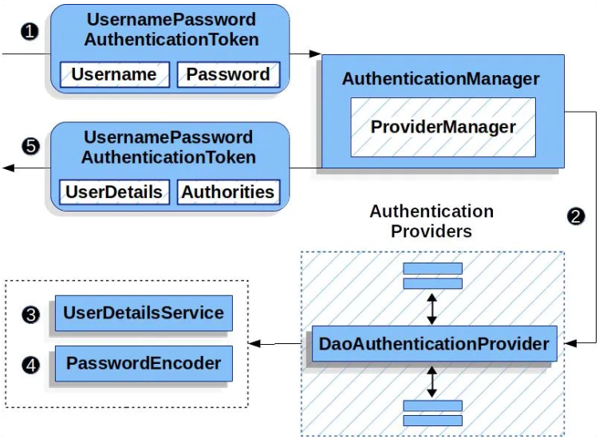

 密码认证完整自动流程



1. 登录请求被拦截
● UsernamePasswordAuthenticationFilter 拦截 /login 请求
● 封装用户名 / 密码为 UsernamePasswordAuthenticationToken（未认证状态）
● 交给 AuthenticationManager（默认 ProviderManager）
1. 找到认证提供者
● ProviderManager 遍历所有 AuthenticationProvider
● 找到支持用户名密码的 DaoAuthenticationProvider
1. 加载用户信息
● 调用 UserDetailsService.loadUserByUsername(username)
● 根据用户名查数据库，返回 UserDetails（含加密密码）
1. 自动密码验证（框架核心）
进入父类 AbstractUserDetailsAuthenticationProvider
```java
protected void additionalAuthenticationChecks(UserDetails userDetails, UsernamePasswordAuthenticationToken authentication) throws AuthenticationException {
    if (authentication.getCredentials() == null) {
        this.logger.debug("Failed to authenticate since no credentials provided");
        throw new BadCredentialsException(this.messages.getMessage("AbstractUserDetailsAuthenticationProvider.badCredentials", "Bad credentials"));
    } else {
        String presentedPassword = authentication.getCredentials().toString();
        if (!((PasswordEncoder)this.passwordEncoder.get()).matches(presentedPassword, userDetails.getPassword())) {
            this.logger.debug("Failed to authenticate since password does not match stored value");
            throw new BadCredentialsException(this.messages.getMessage("AbstractUserDetailsAuthenticationProvider.badCredentials", "Bad credentials"));
        }
    }
}
```
matches() 由框架自动调用
1. 后续处理
验证通过：生成已认证的 Authentication 对象
存入 SecurityContextHolder，完成登录
